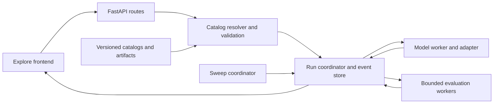

# Steering Lab backend design

Status: target implementation contract. Phase 0 and the initial Qwen catalog/
all-layer extraction slice now ship on this branch, with Formality/
Detoxification × mean/final-token selection through validated v1 vector overrides.
Task presets, editable system instructions, no-system mode and bounded token
budgets now ship through v1. V2 multi-feature run resolution/execution, independent
feature layers, same-layer weighted composition and applied-plan metadata now ship;
see the [implemented run contract](MULTIFEATURE_RUNS.md). The multi-feature
frontend now uses v2 with independent feature banks and a square mixer. Additional
model adapters and live scoring/sweeps remain planned. See
the [all-layer release](../research/steering_experimentation/ALL_LAYER_CATALOG.md)
for the exact implemented coverage and verification.

Reference branch: `nandan/steering-lab-backend`, based on
`521d5576d3bd5185e37e25d9e974d398e7e27626`. The
[phase 0 baseline](../website/PHASE_0_BASELINE.md) remains the regression reference.

## 1. Product and architectural boundaries

Build a reproducible activation-steering experiment service. A user chooses a
supported model, prompt, feature directions, intervention sites, strengths, and
evaluators. The result identifies exactly what ran, including unsuccessful and
partial outcomes. The website visualizes those experiments; it does not define
which combinations exist or calculate invented model-quality scores.

Initially implement one structured Python application with an isolated model
worker and bounded evaluator workers. These are component boundaries, not a
requirement to operate several network services immediately. Preserve FastAPI,
the existing frontend, NDJSON streaming, and the separate T5 extension service.

Support is explicit. A new model architecture needs a tested adapter; a new
direction needs compatible artifacts; a new evaluator needs a versioned metric
definition. The service must reject unsupported combinations rather than promise
that arbitrary models or interventions work without integration.



The model worker owns model memory, tokenization, generation state, and hook
lifetime. The coordinator owns admission, revisions, cancellation, execution
ownership, events, and results. Evaluators own their own scorer lifecycle and
capacity. HTTP handlers translate contracts and never select tensor hooks.

## 2. Domain objects

| Object | Responsibility |
| --- | --- |
| ModelSpec | Pinned model/tokenizer identity, adapter, architecture, prompt capabilities, and compatible runtime profiles |
| RuntimeProfile | Explicit precision, backend/build identity, decoding capabilities, and resource/input/output limits |
| FeatureSpec | Meaning of a direction's positive and negative orientation; not an assertion of successful generation behavior |
| VectorSpec | One immutable vector and its exact compatible model, layer, boundary, pooling, scale, and provenance |
| ExperimentRequest | User intent plus workspace/revision and selected vector IDs, prompt, generation policy, and evaluator IDs |
| ResolvedExperiment | Immutable, validated settings with no unresolved defaults; passed to the worker |
| Run | One admitted execution, its request/configuration identities, lifecycle, output, timings, and evaluation references |
| EvaluationResult | One metric version applied to one immutable source/output pair |
| Sweep | A captured experiment plus a bounded list of parameter assignments and child run IDs |

Keep feature, vector, layer, and pooling separate. A vector belongs to a model and
an extraction/injection site; a layer does not belong to one feature. The current
`dict[layer, strength]` cannot represent two features at the same layer. Replace
it in v2 with a list of interventions referencing VectorSpec IDs.

## 3. Catalogs and artifact provenance

Store human-reviewable manifests in `artifacts/catalog/`. Resolve their artifact
references relative to an operator-configured artifact root. Runtime code must
not depend on paths inside `research/` or accept user-supplied filesystem paths,
model repository URLs, or arbitrary executable adapters.

Model entries record repository ID and immutable revision, tokenizer revision,
adapter ID/version, decoder count, hidden width, supported intervention sites,
prompt formatter/chat-template identity, and permitted runtime/generation policies.
Base models and instruction models may require different prompt formatters.

Every VectorSpec records:

- Stable vector ID and feature ID; compatible pinned model/tokenizer identity.
- Artifact checksum and tensor/candidate key; tensor dimension and finite values.
- Zero-based decoder index and exact activation boundary, initially
  `decoder_block_output` before any subsequent model-level final normalization.
- Extraction pooling, initially `mean` or `final_token`, distinct from the
  inference token scope (`all_tokens` in the first implementation).
- Extraction prompt/context format, attention-mask and token-selection rules,
  source/target orientation, extraction precision, dataset/split identifiers,
  sample/seed metadata, and extraction code version where available.
- Scale policy (`raw` or `unit_l2` initially), original norm, sign, allowed
  strength range, default strength, and evidence behind any tested range.
- Availability/integrity status separately from behavioral validation status.
  An extracted vector may be available for an experimental run without being
  described as benchmarked or scientifically validated.

Legacy artifacts have incomplete provenance. Record unknown fields as unknown;
do not fabricate revisions, precision, extraction seeds, or validation results.
Pin and verify the runtime model snapshot, retaining the uncertainty about the
legacy extraction snapshot until it is established or the vector is re-extracted.

Validate checksums, model compatibility, layer bounds, vector shape, finite
components, and nonzero norm before unit normalization. Check the candidate's
layer/pooling against the manifest. A failure makes that vector unavailable with
a reason; unrelated valid catalog entries remain inspectable. The default model
cannot report generation readiness if its required runtime assets fail validation.

**Activation-site verification is mandatory.** The generic extraction framework
currently takes `hidden_states[1:]`. Do not assume this matches every adapter's
block outputs, especially the final layer around model-level normalization.
Extraction and inference must identify and test the same tensor boundary. Prefer
capturing the adapter's registered intervention sites for new all-layer extraction.

### Inventory and promotion

The legacy Qwen artifacts retain three formality vectors and three non-shuffled
detoxification vectors, plus three shuffled controls. Five existing runtime defaults
are preserved, including index-11 mean/raw formality. The new all-layer release adds
96 experimental vectors and a checked catalog. The v1 compatibility projection now
exposes all 24 indices, using mean/raw formality at newly enabled indices. The
frontend now chooses new-extraction vectors independently per feature, with
separate pooling, layer selections and strengths, and sends explicit v2 interventions. Colours are joined
by exact vector ID. Reset uses new Formality/mean and layer 11 at +0.5; legacy
API defaults remain unchanged. V2 typed run execution remains subsequent work.

The research SmolLM artifact contains 60 vectors; that is an inventory finding,
not a claim of deployment readiness. Verify model identity, boundaries, pooling,
and behavior before promoting it. Controls can later be exposed as explicitly
labeled research controls, not ordinary feature directions.

Reuse `src/secondthought/steering_experiment.py` for extraction after verifying its
adapter and precision assumptions. Full coverage means extracting each desired
model × feature × supported layer × pooling combination, checking it, and promoting
the artifact. Do this offline, independently of interactive inference. Never copy
one layer's direction across missing layers as a substitute for extraction.

The catalog response includes a version/digest, model capabilities, compatible
vector combinations, defaults, metric definitions, limits, and unavailable reasons.
Runtime loading/readiness is distinct from static catalog support. The frontend
derives its layer count and enabled feature/pooling choices from these responses.

The current UI provides the integration locations: `experiment-model` for model
choice, `focused-feature` / `focused-pooling` for direction selection, and
`experiment-prompt` / `system-prompt` for instructions, with `generation-policy`
for decoding. Before v2 integration these fields remain fixed or follow the
focused layer as read-only context. Independent selection must only be enabled
when it resolves to a valid VectorSpec. Inspector tabs already separate quality
metrics/curves from actual run metadata; blank charts are not live measurements.

## 4. Experiment contract

Proposed v2 request; IDs are illustrative catalog identifiers, not shipped entries:

```json
{
  "schema_version": 2,
  "workspace_id": "11111111-1111-4111-8111-111111111111",
  "revision": 42,
  "catalog_version": "catalog-v1",
  "model_id": "qwen2.5-0.5b-instruct",
  "runtime_profile_id": "default",
  "task": "rewrite",
  "source": "hey can u send the report by 3 PM?",
  "system_prompt": {
    "mode": "preset",
    "preset_id": "neutral-rewrite-v1"
  },
  "generation": {
    "policy_id": "greedy-64-v1"
  },
  "interventions": [
    {
      "id": "formality-middle",
      "vector_id": "qwen-formality-l11-mean-raw-v1",
      "strength": 0.5
    }
  ],
  "evaluators": ["surface-v1", "critical-values-v1", "formality-v1"]
}
```

Start with `task=rewrite`. Other tasks become explicit capabilities with their own
prompt formatters and comparison rules; do not pretend every quality metric is
appropriate for free continuation or chat.

The resolver checks catalog version, model/vector compatibility, unique
intervention IDs, strength bounds, finite numbers, count/resource limits, prompt
mode, generation policy, and scorer availability. Reject unknown fields. Reject
duplicate references to the same vector rather than silently doubling it. Distinct
feature vectors may share a layer. Unavailable optional evaluators can be reported
as unavailable without rejecting an otherwise valid generation request.

Prompt modes are `preset`, `custom` with bounded text, and `none` explicitly omitting
the system instruction. Resolve presets to exact text and formatter versions.
Validate mode support per model. Count the entire formatted prompt against the
token limit; never silently truncate it. Show the actual instructions and resolved
settings used for the displayed output. Retain current source trimming and internal
whitespace behavior under a versioned input-normalization policy.

Initial generation policy remains greedy with the phase 0 limits. Later stochastic
policies must include seed, sampling parameters, and replicate identity. Greedy
execution is not a guarantee of bitwise reproducibility across runtime environments.

The returned resolved snapshot contains model/tokenizer revisions, runtime profile,
prompt text/hash and formatter identity, injection sites, vector checksums,
strengths/scales, generation settings, normalization policy, and engine versions.
The worker adds its actual device, dtype, dependency/build identities, and any
execution-environment fingerprint once assigned. Defaults never remain implicit.

### Identity and caching

- `run_id`: one admitted run, independent of source text or settings.
- `(owner, workspace_id, revision)`: idempotency identity for interactive admission.
  The same body returns the same run; different content at the same revision is a
  conflict. A retry must not create a second inference job.
- `generation_fingerprint`: canonical resolved source/prompt/model/vector/runtime
  configuration. Normalize equivalent numbers and sort interventions by stable
  identity; do not round strengths to one decimal if a vector supports finer steps.
- `evaluation_fingerprint`: exact source/output pair plus metric version, scorer
  revision, preprocessing, and annotations/options.
- `comparison_series_id`: the controlled-experiment identity defined in section 8.

Do not include workspace/revision in reusable result identity. Do not include
requested evaluators in the generation fingerprint: requesting another metric does
not require generating the same text again. Keep requested and actually applied
settings distinct. Hashes are identifiers, not anonymization of source content.

Only complete, non-partial outputs can enter the generation cache. Cache hits retain
the original run provenance and measured generation time; record cache lookup/delivery
time separately. They are not new scientific replicates. Do not share results across
owners by default. Reuse only within compatible resolved runtime identities. If
worker assignment changes the runtime identity, check reuse after resolution rather
than serving an output under an incomplete pre-execution cache key. The client must
invalidate its selection cache when the catalog/runtime-availability token changes.

## 5. Execution and model adapters

Define a small adapter interface for model load/unload, capability reporting,
prompt preparation/token counts, site discovery, scoped interventions, streaming
generation, and cancellation. Adapter code is registered and tested in the server;
catalog entries refer to it by ID rather than dynamically importing user code.

Implement the Qwen adapter against the baseline first. Validate the interface with
one additional model, likely the existing SmolLM research checkpoint, before calling
the architecture reusable. Keep extraction code separate from the serving adapter,
but share tested activation-site and pooling definitions where appropriate.

For a given decoder output, the intended intervention is:

```text
h[layer, token] ← h[layer, token] + Σ strength[i] × effective_vector[i]
```

Initially preserve all-token application and the exact current single-vector
scaling/casting behavior. Compile a stable intervention order and one scoped hook
per affected layer. Same-layer composition needs an explicit numerical policy and
tests; do not silently normalize the combined vector or assume orthogonal features.
Any change in accumulation/casting policy receives a version. Test prefill and
cached decoding steps, not just the first forward pass. KV caches are per run and
must never be reused across different steering or prompt configurations.

One generation may execute at a time per mutable model instance. The worker owns
the lock across encoding, hooks, generation, and cleanup. Exceptions, cancellation,
timeouts, and partial output all remove hooks and release ownership. Do not batch
requests with different interventions using ordinary process-global hooks.

Worker residency is bounded. Selecting a model resolves to supported worker capacity;
it does not automatically load every model into one device. Model warming/loading,
busy capacity, unavailable artifacts, and device exhaustion are explicit states.
Never evict an in-use model or change another run's prompt/vector settings.

## 6. Run lifecycle and scheduling

Generation states:

```text
queued → preparing → running → completed
                  ↘ failed / timed_out / cancelled / superseded
```

Queued jobs can also fail, expire, or be cancelled/superseded before execution.
There is one authoritative terminal generation outcome. `completed` can carry
`finish_reason=length` and `is_partial=true`; display that clearly, do not cache it,
and skip automatic quality scoring unless a scorer explicitly supports partials.

Evaluation has an independent state per evaluator:

```text
not_requested | queued → running → ready / unavailable / failed / cancelled / skipped
```

Generation completion enables the completed-output UI immediately. Evaluation
continues after it; evaluation failure does not turn a successful generation into
a failed run. Events may contain several independent metric completions.

Preserve phase 0: immediate submission on slider commit, bounded dragging/typing
debounce, latest revision wins, source-based highlights, cache behavior, and stale
copy protection. The frontend must not wait for evaluation before committing a
new experiment. No Generate button is needed for individual rewrites.

Admission is atomic for an owner/workspace/interactive channel: validate, check
limits, record the new revision/run, replace older pending work, and signal older
active work even if it is on a different model worker. Ignore old cancellation
messages targeting a newer run. Preserve fairness across workspaces and bounded
queues; rapidly dragging one slider must not starve other users.

Explicit sweeps use separate channels and fixed child configurations. They are not
cancelled by the interactive latest-revision rule. A changed draft does not change
an existing sweep's captured source. The UI identifies an older sweep's context;
the user can stop it explicitly. Interactive work gets preference with bounded
sweep capacity and fairness, not an unbounded backlog of grid-search requests.

Retain cooperative cancellation checked at decoding boundaries. A cancellation
request does not mean the device has stopped: worker capacity is released only
after cleanup. A device operation that does not return needs process-level recovery;
timeouts cannot safely start a second run against the same still-running instance.

## 7. API and stream contract

Introduce `/api/v2/lab` alongside the existing `/api/v1/steering` endpoints. Do not
change the v1 stream's terminal-event behavior to append late evaluation events.

| Method and path under `/api/v2/lab` | Purpose |
| --- | --- |
| `GET /catalog` | Versioned models, features, vectors, evaluator definitions, defaults, and capability limits |
| `GET /models/status` | Current worker/runtime availability; no automatic arbitrary model downloads |
| `POST /runs/stream` | Admit an interactive run and stream NDJSON in the same request |
| `GET /runs/{run_id}` | Authorized snapshot of resolved settings, generation result/state, and metric states |
| `POST /runs/{run_id}/cancel` | Idempotent cancellation of that run's unfinished work |
| `POST /runs/{run_id}/evaluations` | Request additional metric versions for an existing completed source/output pair |
| `POST /sweeps` | Admit a bounded explicit sweep; return its ID |
| `GET /sweeps/{sweep_id}` | Sweep specification and child-run/measurement state |
| `GET /sweeps/{sweep_id}/events` | Observe sweep progress and measured points |
| `POST /sweeps/{sweep_id}/cancel` | Cancel pending children and signal active work |

Every event has schema version, sequence number, run ID, workspace/revision,
configuration fingerprint, event type, and server timestamp. Initial events carry
the resolved configuration; subsequent events reference it. Event types include
`run.accepted`, `generation.queued`, `generation.started`, `generation.delta`,
`generation.completed`, terminal generation failure/cancellation events,
`evaluation.started`, `evaluation.result`, `evaluation.failed`, and `run.settled`.

`run.settled` means generation and all initially scheduled evaluators have terminal
states; it does not imply that all succeeded. A later explicit re-evaluation gets
its own evaluation-batch ID and does not regenerate text or reopen generation.

The interactive stream remains open for bounded evaluation work after generation
completion, with lightweight heartbeats while idle. New input supersedes/aborts
the old subscription immediately. Preserve cancellation of unfinished interactive
generation on disconnect. A disconnected cancelled generation is not resumable;
request a new revision to rerun it. Completed results and any retained measurements
remain inspectable within the retention window. Admitted sweeps are observed
independently of a subscriber's connection.

New input cannot supersede an already completed generation outcome. Evaluations
of retained comparison runs may finish within their budgets and update those
history points. Obsolete unretained evaluation jobs may be cancelled before they
consume scorer capacity; record that state explicitly instead of inventing a score.

Bound event buffers and stream backpressure. A slow consumer must not accumulate
unlimited token deltas or block the model worker indefinitely. Retain a snapshot
for resynchronization; never treat a truncated or disconnected stream as success.
Validation/admission errors remain structured HTTP errors; once streaming starts,
worker failures are structured terminal events. A successful HTTP status alone
is not proof of a completed generation.

## 8. Evaluation and graph data model

### Evaluator interface

Each evaluator declares ID/version, supported tasks/languages, scorer/model
revision, preprocessing/aggregation, score names, units/ranges, direction of
interpretation, truncation policy, resource needs, and limitations. A result
contains the immutable source/output hashes, run ID, evaluator identity/options,
status, measured values or null, evaluation duration, and an unavailable/error
reason. Missing, skipped, or failed measurements never become numeric zero.

Reuse current implementations behind adapters:

| Evaluator family | Existing starting point | Presentation |
| --- | --- | --- |
| Text differences | Frontend source diff and `evaluation.evaluation` surface metrics | Edit/length/overlap values, with their word/token definitions |
| Critical values | `extract_critical_values` and `critical_value_metrics` | Extracted values preserved, missing, and unsupported; heuristic limitations remain visible |
| Formality | `RobertaFormalityScorer` / `formality_pair_metrics` | Source, rewrite, and change; record sentence splitting and aggregation |
| Toxicity | `DetoxifyToxicityScorer` | Source, rewrite, and reduction; identify scorer version |
| Semantic similarity | `SentenceTransformerSimilarityScorer` | Model-specific cosine similarity with declared range and preprocessing |
| Entailment | New evaluator, not currently implemented | Source→rewrite and rewrite→source separately, with label mapping and truncation policy |

Audit scorer dependencies and model metadata before enabling each adapter. Do not
run the entire offline `evaluate_records_v2` pipeline unconditionally for every
slider update. Cache reusable source scores and use bounded, independently scheduled
evaluation work. If evaluators share the generation device, arbitrate that capacity
explicitly rather than assuming background tasks cannot affect generation latency.

### Graph views

The Explore inspector should support:

1. **This response:** metric cards with pending/unavailable/error states, source
   and rewrite values, run settings, and links to definitions.
2. **Strength sweep:** measured metric values against one declared intervention's
   strength. Hold every other intervention and experiment setting constant.
3. **Trade-offs:** measured style/toxicity versus similarity or entailment for a
   selected set of runs. Every point is inspectable back to its configuration.
4. **Execution:** queue time, first-text latency, generation time, generated tokens,
   cancellation, partial outcomes, and cache delivery status.

No inferred curves based on alpha, universal optimum marker, or aggregate
"meaning preserved" percentage. Connecting measured points can be a visual guide
if identified as such; it must not imply measurement between the points.

A comparison series freezes source, task, prompt text/format, model/revisions,
runtime compatibility, vectors/pooling/scales, generation policy/seed, metric
versions/options, and every non-varied intervention strength. It identifies the
one varied intervention by stable ID. Varying a model, layer, or pooling starts a
separate controlled series; a trade-off view may compare those series with labels.

For example, changing formality at index 11 while detoxification at index 22 stays
at +0.5 is one series. Changing detoxification to +1 starts another. A point at
formality strength zero is not an all-steering-zero baseline in that example.

Distinguish three references: original input; a generated rewrite with every
intervention zero; and a sweep reference with only the varied intervention zero
and other strengths fixed. Label the comparison used by each displayed delta.

Interactive completed runs may add measured points automatically. Explicit sweeps
capture a finite assignment list, maximum job/token/time budgets, and stop behavior.
Start with one-dimensional sweeps. Later multi-dimensional experiments can use
the same child-run representation, subject to cardinality limits. Stochastic
experiments require replicates; do not use cache hits as independent observations
or draw uncertainty intervals from a single deterministic output.

Measurements belong to retained runs, not the currently visible text node. Late
scores can update the appropriate history point but must never relabel a newer
displayed response. Store data separately from the chart renderer so navigating,
changing tabs, or adding a metric does not require generation again.

The existing `/evaluation` page's offline dataset plots remain a separate view.
They may share metric definitions/renderers but are never presented as live scores
for the Explore user's input.

### Optional internal diagnostics

Expose applied vector norms and scale policies immediately as configuration data.
Measured hidden-state norms or perturbation ratios are opt-in diagnostics requiring
sampling definitions (layer, token position, prefill/decode step), instrumentation
version, and overhead reporting. Do not call decorative layer animations activation
traces. Avoid retaining full hidden-state tensors for ordinary interactive runs.

Define timing boundaries precisely: queue admission→worker start, worker start→first
nonempty decoded text callback, and worker start→generation completion. The current
word-oriented streamer does not directly measure first-token latency. Label any
tokens/total-generation-time ratio as such; it is not isolated decode throughput.

## 9. Storage, ownership, and deployment

Default local runs remain ephemeral with bounded records/events, cache sizes, and
retention. Start with a configurable ten-minute terminal-run retention window;
active worker ownership must not disappear because a retention timer expires.
Keep original text, prompts, outputs, and metrics out of ordinary operational logs.
An explicit export may include source/output and full provenance. Persisting saved
experiments or feedback is a separate deliberate action; do not silently start
saving every draft as part of the refactor.

Workspace UUIDs route revisions; they are not authentication. Public deployment
requires an owner identity for run access/cancellation, quotas, and saved data.
Apply per-owner queue, sweep, input, output, evaluation, and model-loading limits.

Define RunStore, EventStore, and RunCoordinator interfaces. Use bounded in-memory
implementations locally. Before multiple API replicas or separate model hosts,
provide shared transactional admission/idempotency/revision state, execution
ownership, cancellation routing, result storage, and event delivery. A lossy
notification channel is not the authoritative run/event record.

Distributed worker claims need attempt IDs, expiring leases, and fencing so an old
or retried worker cannot publish a second authoritative completion. A worker crash
or ambiguous partial stream is recorded; never silently splice a restarted run's
text into an old stream. Explicit retries have traceable attempts and budgets.

Keep model workers warm and bound residency by device memory. API and evaluator
capacity can scale independently through the same contracts. CPU/GPU images have
explicit dependency/runtime profiles; the current Linux CPU-wheel selection must
not accidentally become the GPU deployment image. Add readiness, graceful drain,
worker-loss recovery, resource telemetry, and streaming integration checks before
AWS rollout. Select infrastructure capacity from measurements rather than model
count alone. Infrastructure creation/deployment is not part of this design change.

## 10. Repository responsibilities and migration

Target responsibilities (introduce modules as their phase needs them):

```text
src/secondthought/lab/
  contracts.py          # Frozen requests, resolved experiments, results and events
  catalog.py            # Manifest loading, validation, capabilities and resolution
  engine.py             # Request-scoped intervention compilation and execution
  adapters/             # Explicitly registered model/activation-site adapters
  evaluators/           # Versioned adapters around existing/new scorers
  coordinator.py        # Admission, revisions, cancellation and execution ownership
  stores.py             # Run/event storage interfaces and bounded local versions
  sweeps.py             # Controlled series, budgets and child-run scheduling
website/api/
  server.py             # App composition, pages, health and legacy routes
  lab_routes.py         # v2 HTTP/NDJSON translation and ownership checks
artifacts/catalog/      # Versioned model/vector/evaluator manifests
research/               # Offline extraction and validation before promotion
```

The extension, Gradio entry point, and offline evaluation outputs remain separate
consumers. Preserve existing imports while moving behavior behind tested interfaces.
Do not move research datasets or model weights into the package or public assets.

| Phase | Implementation boundary | Acceptance gate |
| --- | --- | --- |
| 0 | Slider commit and baseline | Immediate release, no duplicates, preview exclusion, real-generation checks |
| 1 | Catalog schema/loader, provenance, read-only capabilities | Known/unknown provenance honest; checksums/dimensions/sites checked; no inference change |
| 2 | Qwen adapter, immutable experiment and intervention engine, v2 contract | Default baseline preserved; same-layer composition, prompts, errors and hook isolation tested |
| 3 | Catalog-driven UI, model/pooling/feature/prompt controls, second model | Every enabled control reaches applied settings; phase 0 scheduling/cache/revision behavior survives |
| 4 | Evaluator adapters, independent metric lifecycle, live graphs and bounded sweeps | Correct run/series association, baseline labels, late-result handling, scoring failures isolated |
| 5 | Shared coordination and deployment adapters where needed | Multi-client and multi-worker ownership, recovery, limits and streaming verified |

Keep v1 available while v2 develops. In phase 1, project the legacy five-layer
manifest from the verified catalog where possible, retaining existing keys/defaults
and current execution. Do not require a new frontend or scorer to validate the catalog.
In phase 2, keep an explicit legacy adapter translating v1 layer strengths into
known vector IDs; `{}` means no interventions and omitted strengths preserve the
existing index-11 alpha behavior. Mark legacy alpha/beta fields as compatibility
fields, not a complete description of a multi-feature run.

Move the UI to v2 only after its default and multi-layer paths pass the same real
model and browser checks. Keep request/response migration reviewable independently
from extraction and scorer additions. Retire legacy paths only after confirming
their remaining callers; do not delete them just because the new page works.

## 11. Required verification before expanding scope

- Unit: catalog/version/integrity failures, compatibility, pooling/boundaries,
  canonical fingerprints, multiple directions per layer, zero-intervention behavior,
  prompt mode/token limits, unknown fields, and unsupported model/site rejection.
- Engine: hooks and locks on success/failure/cancel/timeout, all-token application,
  prefill/decode behavior, single-instance isolation, and the phase 0 Qwen default.
- API/coordinator: idempotent admission, atomic latest-revision replacement,
  cross-model cancellation, fairness, full queues, explicit terminal outcomes,
  disconnect/backpressure behavior, and generation/evaluation state independence.
- Evaluation/graphs: scorer versioning, unavailable dependencies, partial outputs,
  source-score caching, late/reordered results, series invalidation, true baseline
  identity, deterministic cache reuse versus replicates, and sweep cancellation/budgets.
- Browser: phase 0 release checks, actual request payloads/applied metadata,
  preview exclusion, rapid control changes, Clear/retry, highlighting against the
  source, model loading, evaluator pending/error states, and responsive graph panels.
- Promotion/release: compare extraction and injection boundaries on supported
  adapters; evaluate frozen regression inputs on declared environments; preserve
  configuration/provenance exports; load-test cancellation and worker recovery.

The initial phase 1 slice is implemented: manifests, checked loading, pinned-model
support, read-only catalog API, complete Qwen extraction, and preserved legacy
defaults. A small typed intervention resolver/hook context supports offline checks
of every vector and same-layer composition. Next is the immutable v2 experiment/run
contract and serving adapter integration, followed by wiring independent frontend
choices; the existing compatibility generation path remains the regression reference.
