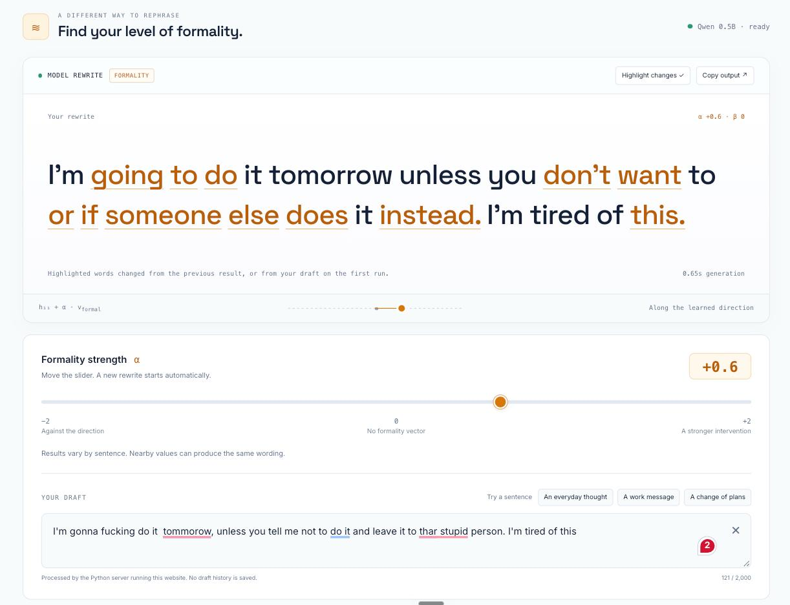

# SecondThought: Weekly Report

## Shipped this session

- Redesigned the extension's popup and added a settings page (PR #46):
  - The popup shows the suggestion with removed words struck out and new ones highlighted, a **Spotted** row with what was flagged, and a **Kept as written** row with the numbers, dates and amounts the rewrite kept. The API now returns these as `kept_values`.
  - The settings page switches the in-page pill on or off everywhere, chooses what triggers it (swearing, harsh words, texting shorthand, shouting), turns sites back on, and checks whether the local server is running.
  - The nudge now runs on any website instead of six named sites. Chrome therefore warns at install that the extension can read and change data on all websites.
  - The in-page card is reduced to the suggestion and its buttons, and clicking outside it closes it.
- Added formality evaluation (PR #50): a sentence-level formality score, rule-based register markers, `evaluation_v2` (the existing metrics plus formality columns) and an `add_formality` command that scores an existing evaluated CSV. First run on the `both-t5` rewrites of the 35 workplace messages.
- Restructured the repository so the Chrome extension and the planned website each have their own frontend and backend, sharing one core library (PR #51).
- In progress, not merged: moving `evaluation.py` and `evaluation_v2.py` into a new `src/evaluation/` package, with every reference updated (branch `aym/evaluation-package`).
- Built a MVP of main website for product.

## Formality evaluation results

The scorer is [`s-nlp/roberta-base-formality-ranker`](https://huggingface.co/s-nlp/roberta-base-formality-ranker), run on each sentence of the original and the rewrite (0 is informal, 1 is formal). Register markers are rules with no model: texting words, ALL-CAPS words, repeated `!!` or `??`, emoji and a lowercase "i". There are no thresholds and no pass/fail, so the values are raw.

| Metric (`both-t5`, 35 workplace messages) | Value |
| --- | ---: |
| Mean formality of the original | 0.558 |
| Mean formality of the rewrite | 0.800 |
| Mean formality gain | +0.242 |
| Mean formality of the least formal sentence in each rewrite | 0.690 |
| Rewrites with a positive gain | 32/35 (91.4%) |
| Rewrites with no register marker left | 35/35 |

Spot check of the label mapping (probability the sentence is formal):

| Sentence | P(formal) |
| --- | ---: |
| "I would be grateful if you could send the report by Friday." | 0.961 |
| "Please replace it before merging." | 0.997 |
| "This rollout is a complete shitshow." | 0.150 |
| "yo u gonna send that report or what lol" | 0.005 |

- Formal is not the same as polite. "Do not dump your unfinished stuff on me..." scores 0.995 formal, while a short, correct "Roll it back before the demo." scores 0.28. The formality columns have to be read next to the toxicity columns, never instead of them.
- The 35 messages contain no texting words, so the marker-free rate of 35/35 says nothing about casual input yet.
- Added 14 tests (3 for `evaluation_v2`, 11 for the formality code). Most use a fake scorer; one runs the real model.

## Repository structure

Each product now has a frontend and its own backend, and the two backends share the core library without importing each other.

```text
extension/frontend/     the Chrome extension (load this folder in Chrome)
extension/api/          its local backend, runs on the user's machine
website/frontend/       empty placeholder, tech stack undecided
website/api/            empty placeholder, planned for EC2 or Lambda
src/secondthought/      shared core: rewriters, facts guard, config, evaluation
research/               notebooks, steering experiments, reports, outputs (not shipped)
artifacts/              steering vectors the product loads, copied from research
tests/                  now tracked in Git
```

- 92 files changed: 71 renames with history kept, 11 added, 10 edited. `make` starts the extension's local API and `make test` runs the suite.
- Added 13 tests: 9 for the API (the response contract, error codes, CORS limited to Chrome extensions, and a server with a broken config reporting it instead of crashing) and 4 for config loading.
- A config file can now live anywhere in the repo. Before, `config.py` assumed it sat one folder below the root, which would have pointed the moved config at `extension/models/` instead of `models/`.
- Checked after the move: the real server returns the same rewrites as before, and the facts guard still keeps "2.5%" and "4%".

## Local server footprint

Measured on one machine (16 GB RAM, 10 cores) with the real `both-t5` model behind the extension's local API. The model file is 242 MB on disk.

| | Idle | While rewriting |
| --- | ---: | ---: |
| Memory (macOS physical footprint) | about 370 MB | about 400-420 MB |
| CPU | about 0% | about one core (90-110%) |

Over 9 requests (three messages, one a paragraph of about 90 tokens), the median latency was 300 ms and the range 217 ms to 1.4 s. macOS compresses idle memory, so `ps` shows only about 12 MB for the idle process and understates the real cost.



## User / validation learning

- No user trials are recorded in the repository this week, so there is no user-derived learning yet.
- A formality score does not measure politeness. The scorer rates a blunt but grammatical command as highly formal, so it can reward the wrong thing if used alone.
- Running the nudge on every site has a trust cost. Chrome's install warning says the extension can read and change data on all websites, even though spotting stays in the page and text only goes to the local server when the user clicks the pill.
- The popup now shows which numbers, dates and amounts were protected. Whether that makes users trust the rewrite is untested.

## Evaluation blockers

- The formality scorer is uncalibrated. It was trained outside the workplace domain on GYAFC and a related corpus, and GYAFC is also what the `formalize` step was trained on, so it may favour our formalizer's style. Its licence is CC BY-NC-SA 4.0 (non-commercial), which limits it to evaluation.
- The sendable gate still has no human labels, so its thresholds stay provisional (carried over).
- No good toxi

## Next session goals

1. Test different evaluation metrics
2. Score SmolLM2 with the same metrics and sendable gate as `both-t5`, and run the formality scorer on it and the steering outputs (carried over, not done this week).
3. Label about 100 rewrites with "Would you send this to your manager as-is?" and use them to calibrate both the sendable gate and the formality scores.
4. Decide the website's tech stack and where its backend runs (EC2 or Lambda), then fill `website/frontend` and `website/api`.
5. Reconcile `requirements-formality.txt` with the project's pinned versions.
6. Test the nudge on live Slack and run the first user trials through it.
7. Fix the carried-over issues: the duplicate `ComparisonRewriter`, the stale `test_infer_epoch3.py`, and the shared end-to-end evaluation command.

## Individual contributions

- Rahul: redesigned the extension's popup and added its settings page (PR #46). The popup now shows what changed and which facts were kept, the nudge runs on any website, and the API returns `kept_values`. Also wrote the session 9 report (PR #45).

- Ziyadh: built the formality evaluation (PR #50): a RoBERTa formality score, rule-based register markers, `evaluation_v2`, an `add_formality` command and 14 tests. On `both-t5`, mean formality rose from 0.558 to 0.800, with 32 of 35 rewrites improving.

- Ayman Sayed: restructured the repository into separate extension and website frontends and backends (PR #51), with 13 new tests and `make` shortcuts. Ran UI tests and performance checks on 20 websites, and measured the local server at about 0.4 GB of RAM and one CPU core. Merged the popup redesign (PR #46); the evaluation package move is in progress.

- Nandan: integrated the finalized Qwen2.5-0.5B steering into the restructured repository and built a first working website around it on the `nandan/website-steering-api` branch: a FastAPI backend and a live, streaming formality-steering page with detoxification disabled. Validated with 61 Python tests, five JavaScript tests, CPU and Apple MPS parity checks, and browser tests with the real model.

## Lean canvas changes

- **Solution:** the nudge now works on any website and has a settings page. A website is planned as a second product with its own hosted backend, but nothing is built yet.
- **Cost structure:** the extension's local server needs about 0.4 GB of RAM and one CPU core while rewriting. A hosted backend will add AWS cost once the website exists.
- **Key metric:** formality gain is a candidate secondary metric (+0.242 on `both-t5`), but it needs calibration and has no pass/fail yet.
- **Channels:** the Chrome extension is still the only channel in use.
- **Primary risk:** still no real users. A new risk is that the extension now asks Chrome for access to all websites, which may reduce trust at install even though spotting stays local.
