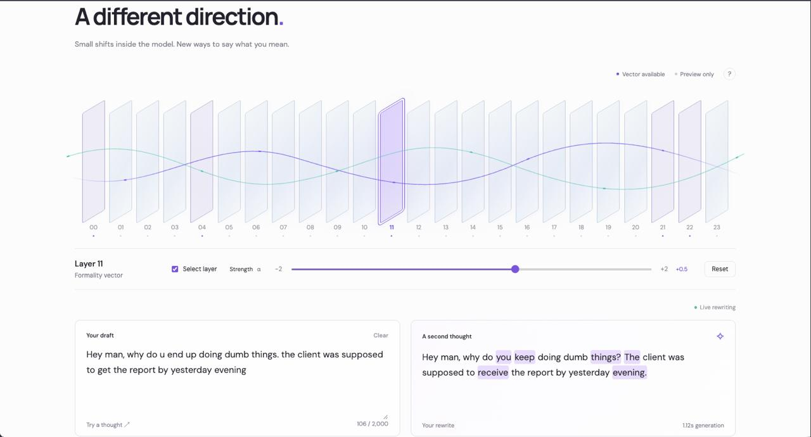
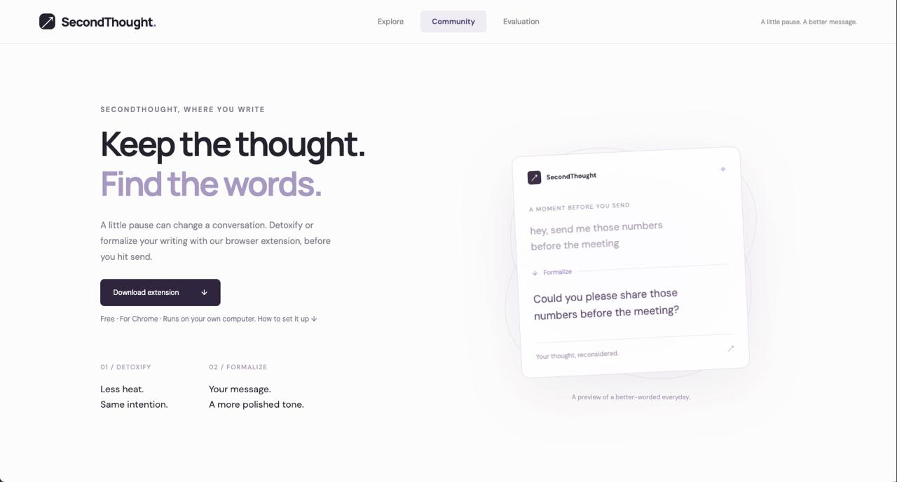
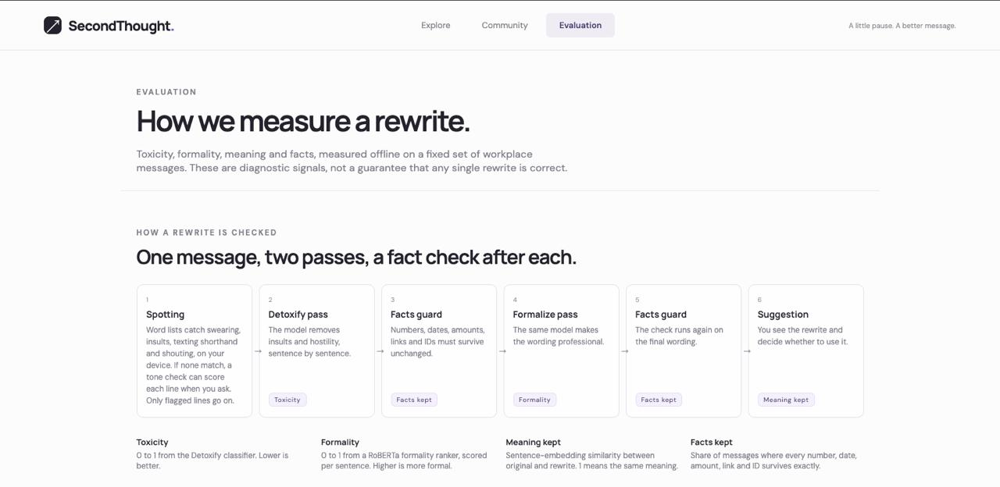

# SecondThought: Weekly Report

## Shipped this session

- Added a second detection layer to the extension (PR #56). After a short pause in typing, a **"Check tone?"** pill offers to check wording the word lists can't judge. On click, a new `/check` endpoint runs Detoxify for toxicity and a GYAFC-trained RoBERTa ranker for informality, then rewrites only the flagged lines or says the message looks good. The instant word list now also includes the open LDNOOBW bad-word list, and shouted short words like "SO" no longer block rewrites.
- Redesigned the website into three pages, **Explore, Community and Evaluation** (PR #55, PR #57):
  - Explore has an animated 24-layer steering visualization with layer selection and an alpha control per layer, a three-column workspace and a response inspector.
  - Rewrite highlighting now compares against the original input.
  - Qwen runs in float32 on MPS devices, which fixed its repetitive output there.
- Made the Community page the extension's home (PR #61, PR #64). It has a working download (a zip built from the extension folder, with install notes inside) and a four-step setup guide with copyable commands and a live check that the local service is running. The extension's popup and settings link back to the guide and to Explore.
- Turned the empty Evaluation page into a results dashboard (PR #58, PR #60, PR #62, PR #63) covering the pipeline, headline scores, a "ready to send" rate, how lightly the model edits, and before/after examples.

| Explore | Community | Evaluation |
| :---: | :---: | :---: |
|  |  |  |

## Evaluation dashboard results

Offline scores for `both-t5` on the 35 workplace messages, as shown on the Evaluation page.

| Metric | Value |
| --- | ---: |
| Toxicity, original → rewrite | 0.60 → 0.06 |
| Formality, original → rewrite | 0.56 → 0.80 |
| Meaning kept (sentence-embedding similarity) | 0.955 |
| Messages with every fact kept | 33/35 |
| Ready to send | 26/35 (74%) |
| Median share of the message changed | 7.5% |

- **"Ready to send"** is a first product-level KPI: one pass/fail per rewrite, combining the toxicity, facts, meaning and "actually changed" checks, with each failure grouped by its reason.
- **The model edits rather than replaces.** 14 of the 21 large toxicity drops came from changing less than 10% of the text.

## Tone check results

| Check | Result |
| --- | --- |
| Speed after warm-up | about 0.17 s for two lines on CPU |
| Informal test lines flagged ("u", "gonna", "Dude") | 4/4, and none of the clean lines |
| Explicit insults flagged by Detoxify | yes (0.86-0.99) |
| Passive aggression ("Did you even read my email?") | missed (0.001) |
| Critical values on the 35 workplace messages | 45/45, unchanged |
| Hostile set flagged by the word lists | 35/35, and none of 9 normal sentences using words like "escort" or "XXX" |

## User / validation learning

- No user trials yet, so there is no user-derived learning this session.
- Classifiers widen what the extension catches, but neither model recognises passive aggression, which is common at work.
- Getting someone else to install the extension is a real hurdle: it needs the project, Python, a model from the team drive and a running local service. The setup guide makes the steps clear, but it doesn't remove them.
- A bug found on teammates' laptops (the download button saving `community.html`) came from a website server started before pulling. Restarting servers after a pull is easy to forget.

## Evaluation blockers

- The dashboard scores a saved batch run made on whole messages without the facts guard, not the live extension path, so its 33/35 for facts differs from the 45/45 the live extension keeps. The two should be reconciled before the final report.
- The tone check's thresholds (0.5 toxic, 0.8 informal) and the ready-to-send rule were set by hand, not fitted to human labels.
- `both-t5` lives only on a team drive. It needs a downloadable home before anyone outside the team can install the extension, and GYAFC's licence may restrict publishing it.
- Carried over: the duplicate `ComparisonRewriter`, the stale `test_infer_epoch3.py`, and a shared end-to-end evaluation command.

## Next session goals

1. Compare the current rewrite with picking the best of 4-6 candidates per sentence, scored on toxicity, facts kept and formality, in a new notebook on the 35 messages.
2. Re-run the dashboard on the live pipeline so the website and the extension report the same numbers.
3. Decide where `both-t5` is hosted (checking the GYAFC licence), and have the service download it on first start.
4. Test the extension on live Slack and run the first user trials.
5. Plan the final demo and the one-step installer.

## Individual contributions

- Rahul: added a second detection layer to the Chrome extension so it no longer depends only on a hand-written word list (PR #56). After a short pause in typing, a "Check tone?" pill offers to check wording the lists can't judge. On click it calls a new `/check` endpoint that runs two local classifiers, Detoxify for toxicity and a GYAFC-trained RoBERTa formality ranker for informality, and then either rewrites only the flagged lines or confirms the message looks good. The classifiers load in the background, both models and thresholds are swappable in `extension/api/config.toml`, and checks take about 0.17 s on CPU. The instant trigger list now also includes the open LDNOOBW bad-word list (minus terms that are normal at work), and shouted short words like "SO" no longer block rewrites, while real acronyms such as IT and GDPR stay intact. Also made the website the extension's home (PR #61, PR #64). The Community page now offers a working download (a zip built from the extension folder, with install notes inside) and a four-step setup guide covering unzipping, loading the extension in Chrome, starting the local service (with a live check that it's running) and pinning it, with copyable commands and notes on updating, troubleshooting and privacy. The extension's popup and settings page link back to the guide and to the website's steering controls. Everything runs locally for now, with one setting per address to switch once the site is deployed. Critical values on the workplace set stay at 45/45, and the website and extension API tests pass, as does the website's browser test against the real Qwen model.

- Ziyadh:
  - **Turned the empty evaluation page into a results dashboard**, merged as PR #58, by building 5 sections from the offline evaluation of our model on 35 workplace messages: pipeline, headline scores, ready-to-send, light touch, and before/after.
  - **Showed the model's impact in four headline numbers:** toxicity 0.60 → 0.06, formality 0.56 → 0.80, meaning kept 0.955, and facts kept in 33 of 35 messages. I did this by turning the scored results into a data file and interactive charts.
  - **Introduced a "ready to send" product KPI, at 26 of 35 rewrites (74%),** by combining the toxicity, facts, meaning and changed checks into one pass/fail rule, with each failure grouped by its reason.
  - **Showed that the model edits rather than replaces messages:** the median message changes 7.5%, and 14 of 21 large toxicity drops came from under 10% of the text changing. I did this with a swarm chart and a change-vs-toxicity scatter.
  - **Kept the page accurate and on-brand,** with 32 website tests and 5 JS tests passing:
    - matched the pipeline to the current trigger code;
    - corrected the model names;
    - used only the site's palette, checked for colour-blind readers.

- Ayman Sayed: redesigned the website into Explore, Community and Evaluation, and built an animated 24-layer steering visualization with layer selection and individual alpha controls (PR #57). Fixed repetitive Qwen output on MPS devices by switching inference to float32.

- Nandan: fixed rewrite highlighting to compare against the original input, redesigned the steering lab into a three-column workspace, and added a response inspector with run details and word-change statistics (PR #55). Expanded the browser checks and updated the website documentation.

## Lean canvas changes

- **Channels:** the website is now the front door for the extension. The Community page hosts the download and setup guide, and the extension links back to the site.
- **Key metric:** "ready to send" (26/35, 74%) is the first single product-level metric, a candidate to replace reading several scores side by side.
- **Solution:** detection has two layers, instant word lists plus classifiers on request, so the model still only runs when the user asks.
- **Unfair advantage / privacy:** the classifiers also run on the user's machine, so nothing typed leaves it.
- **Primary risk:** installation. Until the model can be downloaded automatically and the extension is in the Chrome Web Store, trying SecondThought takes several technical steps, which will limit user trials.
