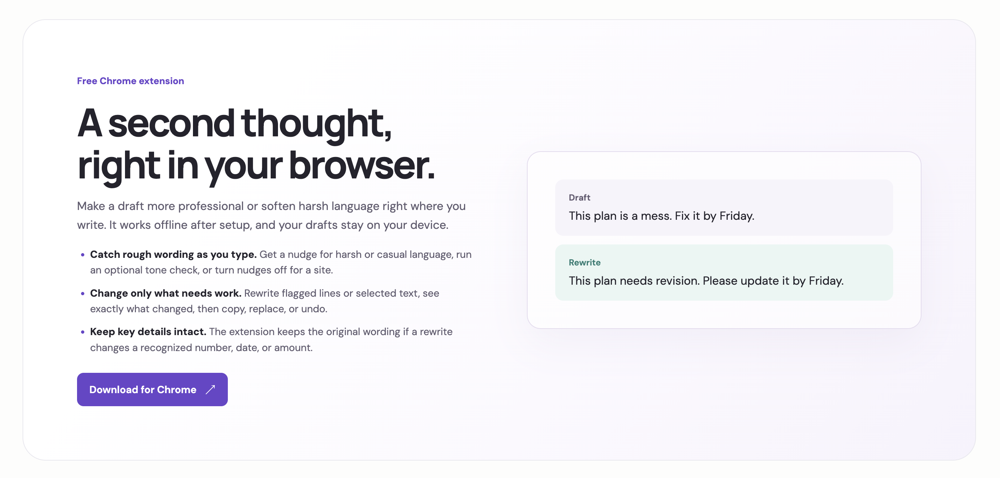
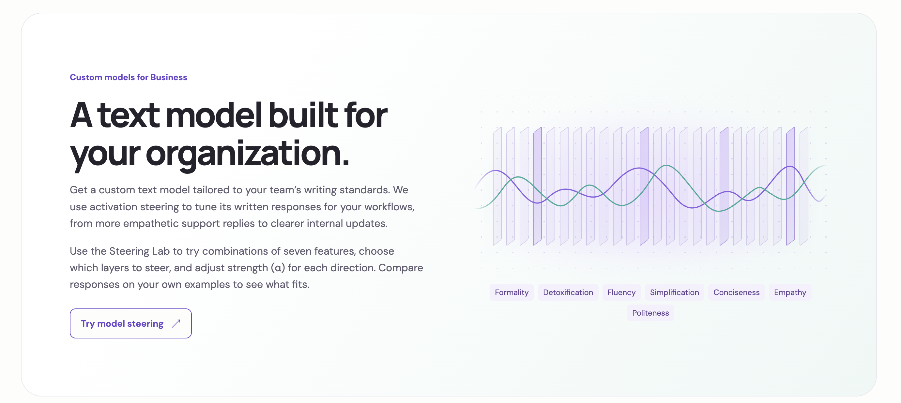
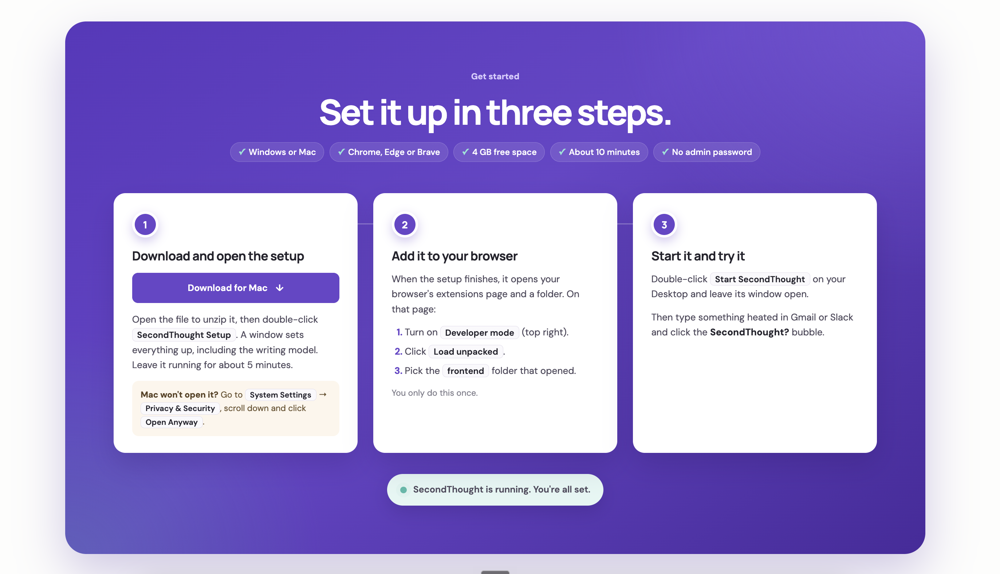
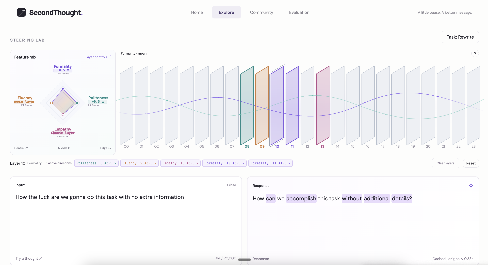
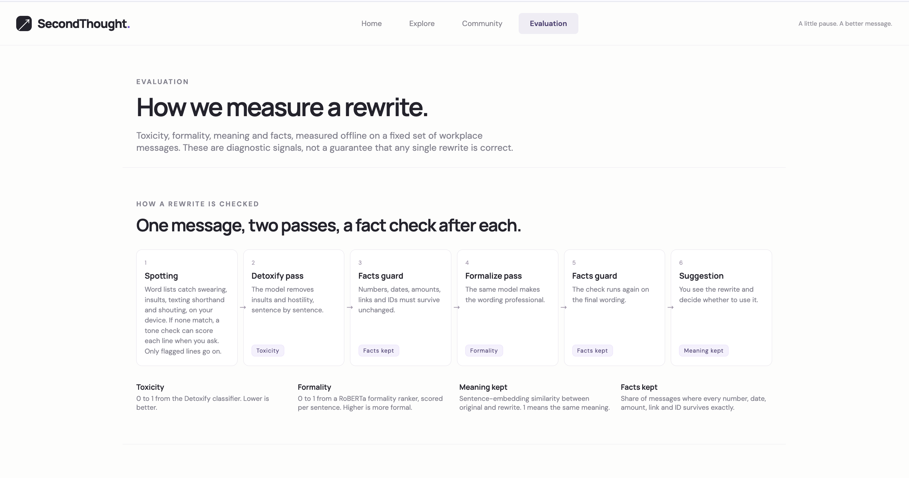

# SecondThought: Weekly Report

Draft for team review. Covers November 18–24, following session 11. Based on the merged history through PR #83; no new user-trial or model-quality results are assumed.

## Shipped this session

- Expanded the Qwen Steering Lab from a formality experiment into a catalog-backed, multi-feature workspace ([PR #68](https://github.com/ayman-tech/SecondThought/pull/68)):
  - Each feature has independent layer selections, strengths and extraction pooling. Multiple features can act on the same layer or different layers in one run.
  - Added all-layer fluency, empathy and politeness directions alongside formality. The current webpage exposes four features × 24 decoder blocks × two pooling choices: **192 selectable directions**.
  - Added task presets and editable system instructions, with configurable input/output token budgets. Continue uses assistant prefill; **Rewrite & continue** rewrites first and then extends the rewritten passage within one job's output budget and deadline.
  - Added source preparation, extraction, catalog promotion and verification commands, with provenance and split fingerprints. Synthetic empathy experiments use a separate catalog rather than replacing the default vectors.
- Simplified the lab controls ([PR #81](https://github.com/ayman-tech/SecondThought/pull/81)). Feature Mix is now the main feature/strength control, with a four-axis spider-web for **Formality, Fluency, Empathy and Politeness**. Clicking layers toggles them directly; the enable checkbox, single/multi-layer toggle and setup sidebar are gone. Task and Layer controls retain instructions, limits, pooling and precise sliders. Unselected layers are neutral, selected layers take their feature's colour, and shared layers use stripes. Removed the accuracy heat scale and scores below the tiles.
- Connected the response inspector to live evaluation ([PR #78](https://github.com/ayman-tech/SecondThought/pull/78)). Each completed response can be scored for formality and toxicity; Rewrite also receives sentence-embedding similarity and critical-value checks. The Curves tab plots formality and toxicity across completed responses over time. Older scores are discarded when a newer revision replaces them, and the previous response stays visible while typing starts a new run.
- Added a dedicated product homepage linking the extension and Steering Lab ([PR #77](https://github.com/ayman-tech/SecondThought/pull/77)).
- Reduced extension setup to downloadable Windows/macOS setup files or terminal installers, with a rewritten Community guide, Desktop launcher, automatic model download and release packaging ([PR #80](https://github.com/ayman-tech/SecondThought/pull/80)). Model lookup now points to the `SaiRahul5` Hugging Face account, with GitHub release assets as a fallback. The extension version was bumped to 0.3.0 and a tag-triggered release workflow was added.
- Redesigned Community to match the homepage, with an interactive rewrite demo, a three-step setup panel, FAQs and separate developer commands. Fixed the developer OS tabs and Copy buttons ([PR #82](https://github.com/ayman-tech/SecondThought/pull/82)).
- Redesigned the extension settings page with trigger-category switches and example chips, paused-site controls, help links and a clearer service-status card. Settings now refresh service status every four seconds while visible; the popup also refreshes its status while open and clears a server-error banner when the service recovers ([PR #83](https://github.com/ayman-tech/SecondThought/pull/83)).
- Documented installation of the evaluation dependencies and scoring-model downloads ([PR #79](https://github.com/ayman-tech/SecondThought/pull/79)). Added Docker/Compose files and an AWS demo runbook for `us-east-2`, initially accessed through an SSH tunnel (PR #81). These are deployment preparations, not evidence of a running public service.

### Website screenshots

**Homepage — browser extension overview**

**Homepage — business and steering overview**

**Community — three-step extension setup**

**Steering Lab — feature mix and independent layer selections**

**Evaluation — rewrite pipeline and measurement overview**

The business overview screenshot retains older seven-feature copy; the current lab exposes four features as described above.

## Steering pipeline and validation results

The extraction method remains target-minus-source mean differences, using either masked mean pooling or the final non-padding token at each decoder block. PCA and other direction estimators were not added. Hooks apply the resolved shifts at the selected block outputs during prompt processing and generation.

| Check | Result / scope |
| --- | --- |
| Current visible controls | 4 features × 24 layers × 2 poolings = 192 |
| Latest merged-code validation | 106 website API tests and 19 frontend tests passed |
| Browser routing check after cleanup | All 192 visible control combinations resolved to their expected backend vectors; completion text was stubbed |
| Numerical reproduction for the newly added visible features | All 48 candidates reproduced for each of fluency, empathy and politeness; maximum absolute raw-vector error 0 in the recorded float32 MPS environment |

Formality's raw-data extraction could not be independently reproduced because the restricted GYAFC corpus was unavailable locally. These checks establish routing and numerical correctness, not improvement in generated writing. Details and limitations are recorded in the [integration review](../docs/STEERING_INTEGRATION_REVIEW.md).

## New feature data and empathy experiment

| Feature | Source / contrast | Extraction / held-out pairs |
| --- | --- | ---: |
| Fluency | IteraTeR-HUMAN revisions labeled `fluency` | 542 / 84 |
| Empathy | EPITOME responses with annotated emotional-reaction spans removed → original response | 417 / 105 |
| Politeness | High-scoring requests with standalone `please` removed → original request | 2,000 / 500 |

- **The existing empathy and politeness pairs are derived contrasts**, not human-rated parallel rewrites. Their high held-out separation can reflect span length or the presence of a courtesy marker rather than general empathy or politeness.
- Built an [empathy generation notebook](../research/steering_experimentation/empathy_synthetic_steering.ipynb) around 50 fixed original messages. A teacher model rewrites the same speaker's message more empathetically, preserving requests, facts, deadlines and stance. These are original/rewrite pairs, not a question paired with an empathetic answer.
- The planned pilot split is **30 extraction / 10 held-out ordering / 10 reserved test**. The notebook supports authenticated teacher generation, resumable outputs, source-copy checks, pair inspection and export, then the existing all-layer extractor and a separate test catalog with 48 empathy directions.
- The notebook and pipeline are merged. A reviewed dataset and controlled behavioral comparison are still needed before claiming the synthetic directions outperform the existing ones. Generated local experiment data is separate from the default catalog.

## Live evaluation

The inspector uses the same scorer implementations as the evaluation pipeline: the RoBERTa formality ranker, Detoxify, `all-mpnet-base-v2` and the rule-based critical-value check. Similarity and value preservation are shown only for Rewrite, where comparing the response with the original is appropriate.

- Scoring is separate from generation. Missing dependencies or unavailable scoring models are reported without preventing the lab from generating text.
- The over-time chart records completed responses in the current tab. It is not a controlled alpha sweep: text, prompt, layer and feature changes can all differ between points.
- No new aggregate model-quality benchmark is reported this week. Session 11's 35-message `both-t5` scores remain historical results; they should not be presented as Qwen steering results.

## User / validation learning

- In our own experiments, formality produced clearer visible changes than the newer directions. This is an observation, not a measured ranking of the features.
- Multi-layer steering made it easy to accumulate interventions unintentionally. Direct toggles, per-feature saved-layer details and explicit active-direction chips make the applied plan easier to inspect.
- Held-out activation separation was confusing as a layer colour: it looked like a recommendation for generation quality. Colour now identifies selected features instead.
- Strong or combined interventions can still cause repetition, semantic drift or incoherent output. Correct artifact routing alone does not prevent this.
- Installers reduce the manual steps identified last week, but there is no new recorded external-user trial in this reporting window. Cross-platform installation and live Slack use still need confirmation.

### 🎥 User Trial Video

## Evaluation blockers

- Fluency, empathy and politeness lack a held-out generation benchmark and human validation; dataset artifacts may drive apparent gains.
- Steering strengths are uncalibrated across features/layers, and combined interventions have no shared perturbation limit.
- Transfer from raw-text extraction to summarization, answering and continuation is unverified.
- The synthetic empathy pilot is too small for reliable layer ranking and still needs pair review.
- Inspector scores cannot guarantee preserved meaning; feature-specific fluency, empathy and politeness scoring is missing.
- AWS deployment, GPU availability, credit coverage and operating costs remain unverified.

## Individual contributions

- Nandan: built the catalog-backed multi-feature steering backend and independent feature/layer/pooling controls; added the fluency, empathy and politeness pipelines alongside formality; audited extraction and hook integration; added the synthetic empathy generation/extraction notebook and isolated test-catalog workflow (PR #68). Added Docker/Compose deployment preparation and the AWS runbook, then simplified the lab to four visible features, direct layer toggles, a spider-web mixer and feature-based tile colours while integrating the latest scoring and website changes (PR #81).
- Ziyadh: connected completed lab responses to formality, toxicity, rewrite similarity and critical-value scoring; added the over-time chart, smoother chart updates and preservation of the visible response while a newer run is loading (PR #78). Updated the setup instructions so the scoring dependencies are installed and the initial model-download/loading behavior is explained (PR #79).
- Ayman Sayed: added the dedicated product homepage, separating the overview of SecondThought from the interactive Explore workspace and linking visitors to the extension and lab (PR #77). Built two interactive homepage demos: a recorded extension rewrite with highlighted changes, Replace, and Undo, and a steering preview covering all 16 combinations of Formality, Fluency, Empathy, and Politeness. Verified both on desktop and mobile, including keyboard controls.
- Rahul: built Windows and macOS/Linux installers, downloadable double-click setup files, Desktop launch support, automatic model download and tag-triggered extension release packaging, including the updated Hugging Face model location and GitHub release fallback (PR #80). Redesigned Community to match the homepage, adding an interactive rewrite demo, a three-step setup panel and FAQs, and fixing the developer OS tabs and Copy buttons (PR #82). Reworked extension settings with a bolder header, trigger-category switches and examples, paused-site controls and a live service-status card. Both settings and the popup now refresh service status every four seconds while active, so starting or stopping the service is reflected without reopening them; the popup clears its server-error banner after recovery (PR #83).

## Lean canvas changes

- **Solution:** two distinct workflows now have clearer homes: the local T5 extension for everyday rewriting, and the Qwen lab for experimenting with prompts and activation interventions. The lab is not yet a validated communication filter.
- **Channels:** the homepage and simplified Community setup provide a clearer route from discovering the project to trying the extension or lab.
- **Key metrics:** response-level formality, toxicity and preservation observations are now available during lab use. They complement, rather than replace, the need for human judgments and a controlled benchmark.
- **Cost structure:** the extension remains local. A private AWS demo has deployment files and a budget runbook, but no measured hosting cost or confirmed credit coverage is claimed.
- **Primary risk:** feature reliability. Adding controls and vectors expands experimentation, but newer directions have not yet shown consistent behavioral gains. Synthetic parallel data is the next experiment, not an established fix.
